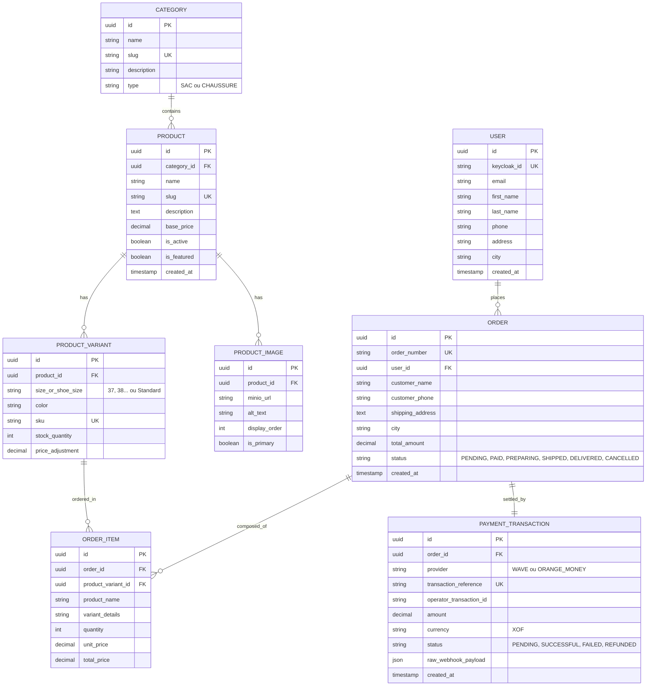

# 📋 CAHIER DES CHARGES FONCTIONNEL ET TECHNIQUE
## Projet : Plateforme E-Commerce « Jumelles Store » (Sacs & Chaussures)

---

## 1. Contexte & Présentation du Projet

### 1.1 Présentation de l'Entreprise
**Jumelles Store** est une enseigne commerciale spécialisée dans la vente au détail et en demi-gros d'articles de mode, plus particulièrement de **maroquinerie (sacs à main, sacs à dos, pochettes)** et de **chaussures (escarpins, baskets, sandales, bottines)** pour hommes et femmes.

### 1.2 Objectif de la Plateforme
Dans le cadre de l'expansion de ses activités et de la modernisation de ses canaux de vente, Jumelles Store souhaite mettre en place une boutique e-commerce moderne, rapide, sécurisée et intuitive, capable de :
1. Présenter l'intégralité du catalogue d'articles avec des visuels de haute qualité.
2. Permettre aux acheteurs de commander en toute autonomie et de payer instantanément via leurs comptes **Wave** ou **Orange Money**.
3. Offrir à l'équipe dirigeante un back-office centralisé pour piloter les ventes, les stocks et la logistique de livraison.

---

## 2. Architecture Technique & Choix Technologiques

Le projet adopte une architecture moderne découplée (Headless / API-driven) conteneurisée :

```
                          ┌────────────────────────┐
                          │   Navigateur Client    │
                          │      / Mobile PWA      │
                          └───────────┬────────────┘
                                      │ HTTPS (Vue.js 3 + Pinia + Tailwind)
                                      ▼
                          ┌────────────────────────┐
                          │   Nginx Reverse Proxy  │
                          └─────┬────────────┬─────┘
                                │            │
           ┌────────────────────┘            └────────────────────┐
           ▼                                                      ▼
┌──────────────────────────┐                              ┌────────────────┐
│   Node.js / Express API  │◄──── OpenID Connect (JWT) ───┤ Keycloak (IAM) │
│ (TypeScript, Zod, REST)  │                              │ Rôles & Users  │
└──────┬────────────┬──────┘                              └────────────────┘
       │            │
       ▼            ▼
┌─────────────┐ ┌──────────────────────────┐
│ PostgreSQL  │ │     MinIO Object Store   │
│ (Données)   │ │  (Images Sacs/Chaussures)│
└─────────────┘ └──────────────────────────┘
       ▲
       │ Webhooks
┌──────┴──────────────────────────┐
│ Passerelles : Wave & Orange M.  │
└─────────────────────────────────┘
```

| Composant | Technologie retenue | Rôle et justification |
| :--- | :--- | :--- |
| **Frontend** | **Vue.js 3 + Vite** | Single Page Application (SPA) réactive, Composition API, Pinia pour l'état global, Tailwind CSS pour un design épuré et moderne. |
| **Backend API** | **Node.js (Express / TypeScript)** | Serveur d'API REST robuste, rapide en I/O asynchrone, validation stricte par schémas, typage de bout en bout. |
| **Authentification** | **Keycloak** | Serveur d'identité et de gestion des accès (IAM) aux standards OAuth2.0 / OpenID Connect. Gestion centralisée des utilisateurs et rôles. |
| **Stockage Fichiers** | **MinIO** | Stockage objet haute performance compatible S3. Stocke les images de produits et les documents avec URLs signées sécurisées. |
| **Base de Données** | **PostgreSQL** | Base relationnelle ACID puissante, supportant les contraintes d'intégrité strictes indispensables à l'e-commerce (stocks, transactions). |
| **Paiements Mobiles**| **Wave API & Orange Money API** | Intégration des moyens de paiement leaders en Afrique de l'Ouest (Sénégal, Côte d'Ivoire, etc.) avec notification webhook instantanée. |
| **Déploiement** | **Docker & Docker Compose** | Isolation des services, portabilité totale du développement à la production. |

---

## 3. Spécifications Fonctionnelles Détaillées

### 3.1 Espace Public / Visiteur & Client

#### A. Catalogue & Navigation
- **Navigation par Univers :**
  - Univers **Sacs** : Sacs à main, Sacs à bandoulière, Cabas, Pochettes, Sacs à dos.
  - Univers **Chaussures** : Escarpins, Baskets/Sneakers, Sandales, Mules, Bottines.
- **Filtres Avancés :**
  - Par catégorie et sous-catégorie.
  - Par pointure de chaussures (ex: 36, 37, 38, 39, 40, 41, 42, 43, 44, 45).
  - Par couleur (Noir, Marron, Nude, Doré, Rouge, etc.).
  - Par matière (Cuir véritable, Simili cuir, Daim, Toile, etc.).
  - Par fourchette de prix (curseur dynamique min-max).
  - Par disponibilité (En stock / Rupture temporaire).
- **Moteur de Recherche Intelligente :** Recherche textuelle rapide avec autocomplétion.

#### B. Fiche Produit Détaillée
- Galerie multi-photos servie depuis **MinIO** avec zoom interactif et affichage optimisé en WebP.
- Sélecteur dynamique de variantes :
  - Choix de la pointure (désactivation automatique des pointures en rupture de stock).
  - Choix de la couleur avec actualisation des photos correspondantes.
- Guide des tailles (tableau de correspondance des pointures en cm).
- Indicateur de stock en temps réel (*« Plus que 2 articles en stock ! »*).
- Produits suggérés / complémentaires (ex: un sac assorti proposé avec une paire de chaussures).

#### C. Panier d'Achat & Processus de Commande (Checkout)
- **Panier Réactif :** Ajout instantané sans rechargement de page, persistance locale et synchronisation avec le compte client connecté.
- **Validation du Panier :** Récapitulatif clair des articles, quantités, prix unitaires et sous-total.
- **Tunnel de Commande en 3 Étapes Sans Friction :**
  1. **Informations de livraison :** Nom, prénom, numéro de téléphone, ville, quartier, adresse précise, instructions de livraison.
  2. **Choix du mode de paiement :**
     - **Wave :** Redirection vers l'application mobile Wave ou scan de QR code sur ordinateur.
     - **Orange Money :** Saisie du numéro et génération du code d'autorisation OTP ou validation via l'application Orange Money.
  3. **Confirmation & Reçu :** Page de succès instantanée, envoi d'un récapitulatif par SMS / E-mail et génération d'une facture téléchargeable.

#### D. Espace Client (Compte Personnel)
- Inscription et connexion transparente via **Keycloak**.
- Tableau de bord client :
  - Historique de toutes les commandes passées.
  - Statut en direct de la commande (*En attente*, *Payée*, *En préparation*, *En cours de livraison*, *Livrée*, *Annulée*).
  - Carnet d'adresses enregistrées pour commander plus vite.

---

### 3.2 Espace Administration & Gestion (Back-Office)

L'accès au back-office est protégé par le rôle Keycloak `app-admin`.

#### A. Tableau de Bord & Indicateurs Clés (KPI)
- Chiffre d'affaires total (quotidien, hebdomadaire, mensuel).
- Nombre de commandes en attente de traitement et d'expédition.
- Alertes automatiques de réapprovisionnement pour les articles à stock critique.
- Top des ventes (les sacs et chaussures les plus vendus).

#### B. Gestion des Produits & Variantes
- Création / Modification / Désactivation d'articles.
- Gestion multi-variantes indispensable pour la mode :
  - Pour chaque chaussure : association des pointures disponibles et quantité unitaire par pointure.
  - Pour chaque sac : association des coloris et quantité unitaire.
- Upload direct drag-and-drop de photos vers le bucket **MinIO** avec redimensionnement automatique.
- Définition des prix standards et des prix promotionnels temporaires.

#### C. Gestion des Commandes & Logistique
- Visualisation détaillée de chaque commande (détail des variantes choisies, coordonnées du client, preuve de paiement Wave/Orange Money).
- Mise à jour du statut de commande (notification du client à chaque changement).
- Possibilité d'imprimer les bordereaux de préparation et les factures clients en PDF.

#### D. Gestion des Clients & Transactions
- Consultation de la liste des clients inscrits et historique de leurs achats.
- Journal des transactions financières Wave et Orange Money (ID de transaction opérateur, montant encaissé, date/heure, statut de réconciliation).

---

## 4. Spécifications des Intégrations Techniques

### 4.1 Intégration Keycloak (Gestion des Identités)
- **Realm dédié :** `jumelles-store`
- **Clients OpenID :**
  - `jumelles-frontend` (Public Client avec PKCE pour Vue.js).
  - `jumelles-backend` (Bearer-only / Confidential Client pour la vérification des tokens JWT).
- **Rôles applicatifs :**
  - `ROLE_CLIENT` : Droits de passation de commande et gestion de son profil.
  - `ROLE_ADMIN` : Droits complets d'administration sur l'API et le back-office.
- **Sécurisation :** Les requêtes API HTTP portent le header `Authorization: Bearer <access_token>`. Un middleware Node.js valide la signature cryptographique du token via les clés publiques de Keycloak (JWKS).

### 4.2 Intégration MinIO (Stockage Objets)
- **Buckets configurés :**
  - `jumelles-products` : Stockage des photos de sacs et chaussures (accès en lecture publique ou CDN).
  - `jumelles-invoices` : Stockage des factures PDF générées (accès restreint via URLs pré-signées temporaires).
- **Workflow d'upload sécurisé :**
  1. L'admin sélectionne une image sur Vue.js.
  2. L'API Node.js vérifie les droits, compresse/optimise l'image et l'envoie à MinIO via le SDK S3 `@aws-sdk/client-s3` ou le SDK officiel `minio`.
  3. L'URL permanente ou pré-signée est enregistrée dans PostgreSQL.

### 4.3 Intégration Wave API & Orange Money API
- **Wave Checkout API :**
  - Création de session de paiement (`POST /checkout/sessions`) avec montant, devise (`XOF`), numéro de commande et URL de redirection de retour.
  - Réception des Webhooks (`type: checkout.session.completed`) avec validation de la signature du webhook pour basculer la commande au statut `PAID`.
- **Orange Money Web Payment API :**
  - Initialisation de la transaction avec l'API Orange Money (token de paiement et redirection vers la page de paiement sécurisée).
  - Notification Instantanée de Paiement (IPN / Webhook) pour confirmation sécurisée.
- **Idempotence & Sécurité financière :**
  - Stockage des identifiants uniques de transaction pour empêcher tout double crédit.
  - Contrôle strict des montants notifiés par rapport au montant initial du panier.

---

## 5. Modèle de Données Conceptuel (PostgreSQL)



---

## 6. Exigences Non-Fonctionnelles & Sécurité

1. **Sécurité & Intégrité :**
   - Chiffrement SSL/TLS (HTTPS) obligatoire sur tous les points d'entrée.
   - Protection contre les failles OWASP Top 10 (Injections SQL via ORM paramétré, XSS, CSRF, Brute Force).
   - Validation stricte de tous les corps de requêtes entrantes via des schémas de données (Zod ou Joi).
2. **Performance & Vitesse de chargement :**
   - Temps de chargement initial < 2 secondes sur réseau 4G mobile.
   - Compression des images au format nouvelle génération WebP avant mise en cache MinIO.
   - Indexation systématique des colonnes PostgreSQL fréquemment filtrées (`category_id`, `status`, `slug`, `keycloak_id`).
3. **Ergonomie Mobile-First :**
   - Conception 100% pensée pour smartphone (plus de 85% des commandes e-commerce au Sénégal se font sur mobile).
   - Boutons d'action rapides pour les paiements Wave et Orange Money adaptés aux écrans tactiles.

---

## 7. Plan de Déploiement & Environnement Docker

Le projet sera orchestré par un fichier `docker-compose.yml` comprenant :
1. **`postgres`** : Base de données avec volume persistant.
2. **`minio`** : Serveur de stockage d'objets avec console d'administration dédiée.
3. **`keycloak`** : Fournisseur d'identité OIDC connecté à PostgreSQL.
4. **`backend`** : Application API Node.js / Express conteneurisée.
5. **`frontend`** : Application Vue.js compilée et servie via Nginx.
6. **`nginx-proxy`** : Reverse proxy gérant le routage des noms de domaine et le SSL Let's Encrypt.

---

## 8. Modalités de Recette & Validation

La validation définitive des livrables sera attestée par :
- Réalisation sans erreur du parcours complet d'achat : de la navigation jusqu'au paiement simulé par Wave et Orange Money en environnement Sandbox.
- Vérification de la bonne génération des statuts et de la décrémentation automatique des stocks.
- Test de l'upload et de la restitution sans latence des photos dans MinIO.
- Validation des barrières de sécurité et de la gestion des rôles Keycloak.

